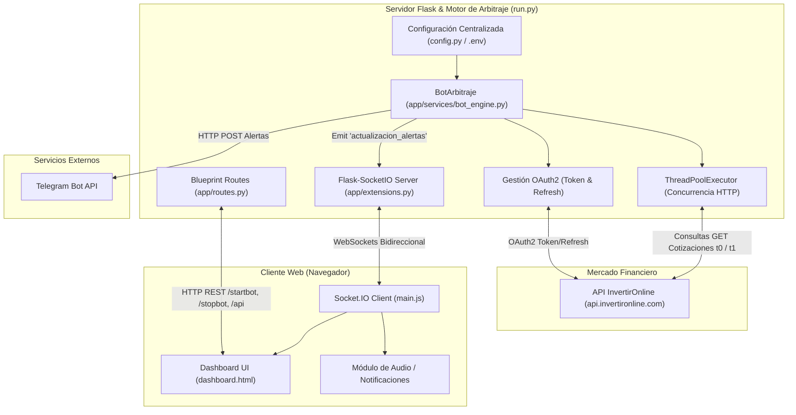

# 📊 Análisis Exhaustivo del Proyecto: Bot de Arbitraje Financiero (IOL)

> **Documento de Arquitectura, Análisis de Código y Diagnóstico Técnico**  
> **Fecha de Análisis:** Octubre 2026  
> **Mercado Objetivo:** BCBA / BYMA (Bolsa y Mercados Argentinos) vía API de InvertirOnline (IOL)  
> **Stack Principal:** Python 3.10+, Flask, Flask-SocketIO, Eventlet, Bootstrap 5, JavaScript Vanilla (WebSockets).

---

## 1. Resumen Ejecutivo

El proyecto **Arbitraje** es una plataforma de monitoreo y detección automatizada de oportunidades de arbitraje temporal de plazos de liquidación en el mercado de capitales argentino. Específicamente, escanea de manera recurrente instrumentos cotizantes en **BCBA / BYMA** a través de la API v2 de **InvertirOnline (IOL)**, comparando cotizaciones en plazo **Contado Inmediato (`t0`)** contra plazo **24 horas (`t1`)**.

Cuando la brecha porcentual (*spread* o *gap*) entre ambos plazos supera un umbral parametrizable (por defecto 2%), el sistema clasifica la oportunidad en una de sus 4 estrategias operativas (`COMPRA`, `COMPRA FUERTE`, `VENTA`, `VENTA FUERTE`), emite alertas en tiempo real hacia una interfaz web interactiva vía WebSockets y, opcionalmente, envía notificaciones push a un canal o chat privado de **Telegram**.

---

## 2. Dominio Financiero: Arbitraje Temporal de Plazos

En el mercado argentino (BYMA), una misma especie o título valor (Acción, Bono soberano, CEDEAR u Obligación Negociable) puede negociarse bajo distintos plazos de liquidación:
- **`t0` (Contado Inmediato / CI):** La operación se liquida y liquida fondos/títulos en el mismo día.
- **`t1` (24 horas):** La operación se liquida al siguiente día hábil.

### Dinámica del Arbitraje
Dado el valor tiempo del dinero, las tasas implícitas (caución bursátil) o fricciones de liquidez momentáneas en el libro de órdenes (*order book*), surgen descalces de precios entre ambos plazos. Si un inversor compra un activo en el plazo más barato y simultáneamente vende el equivalente en el plazo más caro (o arbitra contra colocación/tomadora de caución), puede capturar un rendimiento prácticamente libre de riesgo direccional de mercado.

---

## 3. Arquitectura del Sistema

El sistema sigue una arquitectura modular en capas con patrón Application Factory para Flask, gestión de eventos full-duplex con Socket.IO y ejecución concurrente multi-hilo para la extracción de cotizaciones de mercado.



---

## 4. Estructura de Archivos del Proyecto

```text
arbitraje/
│
├── .github/
│   └── workflows/
│       ├── python-app.yml         # Workflow de GitHub Actions (despacho manual)
│       └── python-arbitraje.yml   # Workflow duplicado / variante de ejecución
│
├── .vscode/
│   └── launch.json                # Configuración de depuración para VSCode (run.py)
│
├── app/
│   ├── services/
│   │   ├── __init__.py
│   │   └── bot_engine.py          # Lógica central del bot, conexión IOL y escaneo
│   ├── static/
│   │   ├── css/
│   │   │   └── style.css          # Estilos personalizados, badges y animaciones
│   │   └── js/
│   │       └── main.js            # Lógica de cliente WebSockets, filtros y audio
│   ├── templates/
│   │   └── dashboard.html         # Panel de control web (Bootstrap 5)
│   ├── __init__.py                # Flask Application Factory (create_app)
│   ├── extensions.py              # Instancia central de SocketIO
│   └── routes.py                  # Endpoints REST y vistas web
│
├── .env                           # Variables de entorno y credenciales (IOL, Telegram)
├── .gitignore                     # Exclusiones de Git (entornos, temporales)
├── config.py                      # Clase de configuración central y universos de tickers
├── README.md                      # Documento inicial de presentación
├── requirements.txt               # Dependencias Python del entorno
└── run.py                         # Punto de entrada de ejecución del servidor
```

---

## 5. Análisis Detallado Módulo por Módulo

### 5.1. `run.py`
Punto de entrada de la aplicación.
- Importa la fábrica `create_app()` y la instancia global `socketio`.
- Inicializa el servidor en modo desarrollo (`debug=True`, host `0.0.0.0`, puerto `5000`) utilizando `socketio.run()` con `allow_unsafe_werkzeug=True`, asegurando la compatibilidad con el servidor de eventos WebSockets.

### 5.2. `config.py`
Contiene la clase `Config`, responsable de centralizar parámetros:
- **Credenciales:** Lectura de `USER`, `PASSWORD`, `TELEGRAM_TOKEN`, `CHAT_ID` mediante `python-dotenv`.
- **Parámetros de Negocio:**
  - `MERCADO = "bcba"`
  - `UMBRAL_VARIACION = 2` (Diferencia porcentual mínima del 2.0% para gatillar alerta).
  - `INTERVALO_MINUTOS = 1` (Pausa entre rondas de escaneo completo).
  - `TELEGRAM_ON = False` (Bandera para habilitar/deshabilitar envíos push a Telegram).
  - `THREADS = 10` (Cantidad de hilos concurrentes para la consulta simultánea de cotizaciones).
- **Universo de Especies (`TICKERS` y `TICKERS_BUY`):**
  - Integra más de 60 activos divididos por tipo:
    - **Acciones locales:** ALUA, BBAR, BMA, BYMA, CECO2, EDN, GGAL, PAMP, SUPV, TRAN, VALO, entre otras.
    - **Bonos soberanos y sub-soberanos:** AE38, BA37D, BB37D, BPOC7, BPOD7, ERF25, NDT25, PMM29, SA24D, T13F6, TX26, S27F6.
    - **CEDEARs:** AAPL, ACN, AMGN, AZN, BHP, BP, CRM, CVX, DIA, HSBC, IWM, MELI, MRK, MSTR, PG, PYPL, QCOM, SE, SLB, SPY, UNH, UPST, VALE, XLE, XOM, etc.
    - **Obligaciones Negociables (Corporativos):** CLSIO, RUCDO, SNEAO, ZZC1O, etc.
    - **Lista `TICKERS_BUY`:** Especies orientadas a compra que restringen la emisión de alertas de venta normal/fuerte (BHIP, COME, SUPV, PBY26, LOMA, TECO2, JNJ, PBR, BYMA, CEPU, IRSA, IREN, LND, PBY26).

### 5.3. `app/__init__.py` & `app/extensions.py`
- Sigue el patrón **Application Factory**: `create_app()` inicializa la app Flask, carga la configuración de `config.Config`, registra el blueprint `main_bp` e inicializa SocketIO.
- En `extensions.py`, se declara `socketio = SocketIO(cors_allowed_origins="*")`, permitiendo conectividad bidireccional sin bloqueos por políticas de origen cruzado.

### 5.4. `app/routes.py`
Define los endpoints HTTP REST:
| Método | Endpoint | Descripción |
| :--- | :--- | :--- |
| `GET` | `/` | Renderiza la interfaz principal (`dashboard.html`). |
| `GET` | `/api/alertas` | Devuelve la lista en memoria de las alertas detectadas en formato JSON. |
| `GET` | `/api/status` | Devuelve el estado actual de ejecución del bot (`{"running": bool}`). |
| `GET` | `/startbot` | Llama a `bot_instance.iniciar()` y arranca el hilo de escaneo asíncrono. |
| `GET` | `/stopbot` | Llama a `bot_instance.detener()`, finalizando el ciclo de escaneo. |
| `GET` | `/api/limpiar` | Purga las alertas en memoria y emite un evento WebSocket `actualizacion_alertas` con arreglo vacío. |

### 5.5. `app/services/bot_engine.py` (Núcleo Operativo)
Es el componente más importante del sistema. La clase `BotArbitraje`:
1. **Manejo de Sesión y Autenticación:**
   - Mantiene una sesión HTTP (`requests.Session()`) para reutilizar conexiones TCP/TLS (Keep-Alive).
   - `_realizar_login_password()`: Solicita un token inicial vía OAuth2 a `https://api.invertironline.com/token` enviando `grant_type="password"`.
   - `_intentar_refresh_token()`: Renueva el token de acceso cuando vence o genera un 401, recurriendo a `_realizar_login_password()` si el refresh falla.
   - Utiliza `threading.Lock()` (`self.token_lock`) para evitar condiciones de carrera (*race conditions*) si múltiples hilos intentan renovar el token al mismo tiempo.
2. **Consulta de Cotizaciones y Puntas:**
   - Método `_consultar_precio_individual(simbolo)`:
     - Realiza dos peticiones GET para cada especie: una con `plazo=t0` y otra con `plazo=t1`.
     - Extrae:
       - `ultimo`: Último precio operado (`ultimoPrecio`).
       - `compra`: Mejor precio de compra en puntas (`puntas[0].precioCompra` - Bid).
       - `venta`: Mejor precio de venta en puntas (`puntas[0].precioVenta` - Ask).
     - Si recibe código HTTP 429 (Too Many Requests), realiza una pausa preventiva con `socketio.sleep()`.
3. **Ejecución Concurrente:**
   - `_bucle_monitoreo()`:
     - Se ejecuta como tarea en segundo plano mediante `socketio.start_background_task()`.
     - Utiliza `ThreadPoolExecutor(max_workers=Config.THREADS)` mapeando concurrentemente `_consultar_precio_individual` sobre la lista de `Config.TICKERS`.
4. **Lógica de Alertas y Estrategias:**
   Calcula la variación porcentual y clasifica según las 4 estrategias:
   - **CASO 1: COMPRA (Normal)**
     $$\text{Gap} = \frac{t0_{\text{bid}} - t1_{\text{price}}}{t1_{\text{price}}} \times 100$$
     Condición: $|\text{Gap}| \ge \text{Umbral}$ y $\text{Gap} < 0$.
   - **CASO 2: COMPRA FUERTE**
     $$\text{Gap} = \frac{t0_{\text{ask}} - t1_{\text{price}}}{t1_{\text{price}}} \times 100$$
     Condición: $|\text{Gap}| \ge \text{Umbral}$ y $\text{Gap} < 0$.  
     *(Oportunidad ejecutable de compra directa en Contado Inmediato).*
   - **CASO 3: VENTA (Normal)**
     $$\text{Gap} = \frac{t0_{\text{ask}} - t1_{\text{price}}}{t1_{\text{price}}} \times 100$$
     Condición: $\text{Gap} \ge \text{Umbral}$ y el símbolo no pertenece a `TICKERS_BUY`.
   - **CASO 4: VENTA FUERTE**
     $$\text{Gap} = \frac{t0_{\text{bid}} - t1_{\text{price}}}{t1_{\text{price}}} \times 100$$
     Condición: $\text{Gap} \ge \text{Umbral}$ y el símbolo no pertenece a `TICKERS_BUY`.  
     *(Oportunidad ejecutable de venta directa en Contado Inmediato).*
5. **Deduplicación y Despacho:**
   - Para no saturar con alertas repetidas, almacena tuplas de estado en `ultimas_alertas_enviadas[f"{simbolo}_{tipo}"] = (tipo, p_in_r, p_out_r, var_r)`.
   - Emite el evento WebSocket `actualizacion_alertas` hacia el frontend.
   - Si `Config.TELEGRAM_ON` está activo, formatea el mensaje en HTML con emojis y lo envía al endpoint de Telegram Bot API.

### 5.6. Frontend: `dashboard.html`, `main.js`, `style.css`
- **Dashboard Reactivo:**
  - Conexión WebSocket mediante `const socket = io()`.
  - Escucha el evento `actualizacion_alertas` y renderiza la tabla sin recargar la página.
  - Al recibir una alerta nueva, dispara un tono auditivo configurable (`sonidoHabilitado`, `beep_short.ogg`).
  - Animación `@keyframes highlight` sobre la fila recién ingresada (`.nueva-fila`) y distinción del último lote escaneado (`.latest-scan`).
- **Filtros Dinámicos:**
  - Dropdown interactivo con checkboxes para ocultar/mostrar independientemente:
    - 🚀 *Compra Fuerte*
    - 🟢 *Compra Normal*
    - 🔥 *Venta Fuerte*
    - 🔴 *Venta Normal*
- **Controles Operativos:**
  - Botón *Iniciar* (llama a `/startbot`).
  - Botón *Detener* (llama a `/stopbot`).
  - Botón *Limpiar* (llama a `/api/limpiar`).
  - Botón *Mute / Unmute* para habilitar sonido en navegadores modernos (requiere interacción previa del usuario).
  - Consulta periódica (`setInterval` cada 10s a `/api/status`) para sincronizar el estado visual del botón y el led indicador (`status-dot`).

### 5.7. Automatización CI/CD: `.github/workflows/`
Existen dos workflows YAML (`python-app.yml` y `python-arbitraje.yml`) configurados para ejecución manual (`workflow_dispatch`), los cuales configuran Python 3.10, instalan dependencias y definen variables secretas en `$GITHUB_ENV`.

---

## 6. Hallazgos Críticos, Bugs y Diagnóstico Técnico

Durante la inspección línea a línea del código fuente se detectaron aspectos que requieren atención inmediata:

### ⚠️ 1. Bug Funcional: Tipo de Alerta "VENTA FUERTE" mal asignado
- **Ubicación:** [app/services/bot_engine.py](file:///c:/Users/LemaMarceloFernand/source/repos/arbitraje/app/services/bot_engine.py#L196-L203)
- **Problema:** En el bloque correspondiente a la estrategia "VENTA FUERTE", el código llama a:
  ```python
  self._procesar_alerta(simbolo, "VENTA", gap_fuerte, t0_bid, t1_price, hora_actual)
  ```
  Debería decir `"VENTA_FUERTE"`.
- **Impacto:** Las alertas de venta fuerte se etiquetan erróneamente como `"VENTA"` simple. En el frontend, el filtro y estilo visual de "🔥 Venta Fuerte" nunca recibe eventos correctos y se pisan con las alertas de venta normal.

### 🚨 2. Seguridad Crítica: Credenciales y Claves Expuestas en `.env`
- **Ubicación:** Archivo `.env` en la raíz del espacio de trabajo.
- **Problema:** Contiene credenciales en texto plano:
  - Usuario y contraseña de InvertirOnline (`USER`, `PASSWORD`).
  - Cuentas secundarias (`USER_PRIMARY`, `PASSWORD_PRIMARY`, `ACCOUNT_PRIMARY`).
  - Token del bot de Telegram (`TELEGRAM_TOKEN`).
  - API Key de Gemini (`GEMINI_API_KEY`).
- **Recomendación:** 
  1. Revocar y rotar inmediatamente todas las claves y contraseñas que hayan sido sincronizadas a repositorios remotos.
  2. Asegurar que `.env` esté estrictamente ignorado en `.gitignore` (actualmente está en `.gitignore`, pero nunca debe subirse al historial de git).
  3. Proveer una plantilla `.env.example` con valores vacíos para despliegues.

### ⚠️ 3. Inconsistencia en GitHub Actions (`python arbitraje.py`)
- **Ubicación:** `.github/workflows/python-app.yml` y `.github/workflows/python-arbitraje.yml` (líneas finales).
- **Problema:** Los workflows intentan ejecutar `python arbitraje.py`. Sin embargo, el archivo ejecutable del proyecto actual es `run.py`, por lo que el pipeline de GitHub Actions fallará al no encontrar el archivo `arbitraje.py`.
- **Recomendación:** Actualizar el comando a `python run.py` o al script headless que se desee ejecutar en GitHub Actions.

### ⚠️ 4. Modelo de Arbitraje: Puntas vs Último Precio Operado
- **Ubicación:** `bot_engine.py`, líneas 174–203.
- **Detalle Financiero:** Las 4 estrategias comparan una punta de `t0` (`t0_bid` o `t0_ask`) contra el **último precio operado** de `t1` (`t1_price`).
- **Riesgo:** El último precio operado en `t1` puede haber ocurrido minutos u horas antes y no representar liquidez disponible en el mercado en ese instante.
- **Mejora:** Para un arbitraje puro ejecutable en ambas puntas sin riesgo de mercado, se debe comparar:
  - **Compra en t0 / Venta en t1:** `t0_ask` (compro pagando ask) vs `t1_bid` (vendo pegándole al bid de 24h).
  - **Venta en t0 / Compra en t1:** `t0_bid` (vendo al bid en CI) vs `t1_ask` (compro pagando el ask en 24h).

### ⚠️ 5. Rate Limiting de la API de InvertirOnline (HTTP 429)
- **Ubicación:** `bot_engine.py`, consulta con `ThreadPoolExecutor(max_workers=10)`.
- **Problema:** Con ~60 tickers escaneados cada 1 minuto y 2 llamadas por ticker (`t0` y `t1`), se efectúan más de 120 peticiones HTTP en ráfaga a `api.invertironline.com`.
- **Impacto:** Si IOL impone cuotas por segundo o minuto, se generarán errores `429 Too Many Requests`. Aunque el código contempla un `socketio.sleep(2)`, el pool de 10 hilos puede insistir saturando la cuota.
- **Mejora:** Implementar un mecanismo de control de tasa (*RateLimiter* con algoritmo Token Bucket o delay intencional de 100-200ms entre llamadas).

---

## 7. Guía de Instalación y Ejecución

### Requisitos Previos
- Python 3.10 o superior.
- Cuenta activa en InvertirOnline con habilitación para uso de API de cotizaciones.

### Pasos de Despliegue Local
1. **Crear y activar entorno virtual:**
   ```powershell
   python -m venv venv
   .\venv\Scripts\activate
   ```
2. **Instalar dependencias:**
   ```powershell
   pip install -r requirements.txt
   ```
3. **Configurar variables de entorno (`.env`):**
   ```ini
   USER=tu_usuario_iol
   PASSWORD=tu_contraseña_iol
   TELEGRAM_TOKEN=tu_token_bot_telegram
   CHAT_ID=tu_chat_id
   ```
4. **Ejecutar la aplicación:**
   ```powershell
   python run.py
   ```
5. **Acceder al panel:**
   Abrir en el navegador [http://localhost:5000](http://localhost:5000).

---

## 8. Matriz de Componentes y Responsabilidades

| Componente | Archivo Fuente | Tecnología | Rol Principal |
| :--- | :--- | :--- | :--- |
| **Entrada Principal** | `run.py` | Python / Socket.IO | Arranque del servidor HTTP y WebSockets. |
| **Configurador** | `config.py` | Python / dotenv | Parámetros de mercado, umbrales y universo de tickers. |
| **Fábrica App** | `app/__init__.py` | Flask Factory | Registro de blueprints y enlace con SocketIO. |
| **Controlador** | `app/routes.py` | Flask Blueprint | Endpoints REST de control y entrega de vistas. |
| **Motor Bot** | `app/services/bot_engine.py` | Requests / ThreadPool | Autenticación IOL, cálculo de gaps y despacho de alertas. |
| **UI Dashboard** | `app/templates/dashboard.html` | HTML5 / Bootstrap 5 | Estructura visual del panel de control. |
| **Cliente Web** | `app/static/js/main.js` | JS (ES6+) / Socket.IO | Gestión de sockets en cliente, filtros en DOM y audio. |
| **Estilos** | `app/static/css/style.css` | CSS3 | Badges semafóricos, estados y animaciones. |
| **CI/CD** | `.github/workflows/` | GitHub Actions | Automatización de tareas de ejecución en la nube. |

---

## 9. Recomendaciones y Hoja de Ruta

1. **Corrección de Bugs Inmediatos:**
   - Corregir el string `"VENTA_FUERTE"` en `bot_engine.py` (Línea 202).
   - Actualizar los archivos `.github/workflows/` para invocar el script correcto.
2. **Robustecer Conectividad IOL:**
   - Implementar reintentos con *Exponential Backoff* y *Jitter* para errores de red o 429.
   - Refrescar el token preventivamente 5 minutos antes de su tiempo de expiración (`expires_in`), en lugar de esperar una excepción HTTP 401.
3. **Evolución a Trading Algorítmico (Ejecución Automática):**
   - Actualmente el sistema es exclusivamente un **monitor de alertas**.
   - Se puede extender para que, ante un spread validado con cálculo de comisiones e impuestos de mercado (derechos de mercado y aranceles del broker), envíe órdenes límite simultáneas (`POST /api/v2/operar/Comprar` y `POST /api/v2/operar/Venta`) ejecutando el arbitraje de manera desatendida.

