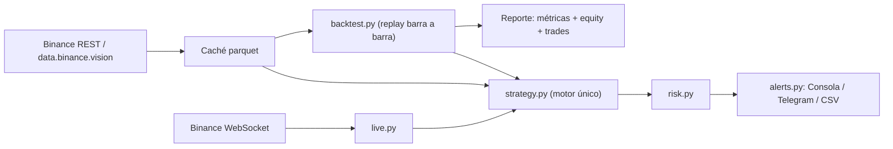

# Plan: Sistema de Alertas Cripto – "Barrido de liquidez sobre zonas de Volume Profile"

> Implementación de la estrategia descripta en [estrategia.txt](estrategia.txt) como un módulo **independiente** del bot de arbitraje BYMA, con dos modos:
> 1. **Live** → monitorea en tiempo real y emite alertas LONG/SHORT con toda la info para operar (entrada limit, SL, TP, R:R, tamaño, palanca, contexto).
> 2. **Backtest** → reproduce exactamente el mismo motor de señales sobre datos históricos, simulando órdenes y midiendo resultados.

---

## 1. Traducción de la estrategia a reglas objetivas

La estrategia es discrecional ("mirar el gráfico"). Para automatizarla hay que convertir cada paso en una regla medible. Esta es la propuesta:

| Paso de la estrategia | Regla cuantitativa propuesta |
|---|---|
| **1. Estructura macro 1D** (tendencia / rango / acumulación-distribución) | Pivots (fractales) sobre velas 1D → secuencia HH/HL = alcista, LH/LL = bajista. **Rango ("cajita")**: los últimos N días (def. 30) están contenidos en un box cuyo alto es < K·ATR(1D) y el precio tocó ambos extremos ≥ 2 veces. **Acumulación vs distribución**: delta de volumen agresor (taker buy − taker sell, viene en las klines de Binance) acumulado en el rango + volumen en tramos subidas vs bajadas. Resultado: sesgo `LONG_PRIORITARIO` / `SHORT_PRIORITARIO` / `NEUTRAL`. |
| Ondas de Elliott | **No se automatiza** (demasiado subjetivo). Se reemplaza por el conteo de swings + sesgo acc/dist. Queda como campo informativo "nº de swings del impulso actual". |
| **2. Zonas históricas / Golden POC** | **Volume Profile** construido con velas 1H de los últimos 12–24 meses: el volumen de cada vela se reparte entre los bins de precio entre su low y high. Se detectan **HVN** (picos del histograma suavizado por encima del percentil 70) y se expanden a una **franja** [zona_low, zona_high] mientras el volumen del bin > 60 % del pico. También POC global, VAH/VAL (70 %). Cada zona recibe un **score de "muralla"**: cuántas veces el precio la tocó y rebotó sin atravesarla con cierre diario. |
| **3. Barrido de liquidez** | Identificar el **último mínimo relevante** (pivot low que originó el último impulso alcista). Condición de barrido: el precio perfora ese mínimo (mecha) **y** la mecha entra en una zona HVN. Espejo para shorts (barre último máximo dentro de HVN superior). |
| Confirmación con BTC | Para altcoins: BTC no debe estar haciendo nuevos mínimos en las últimas X horas (o también estar en su propia zona/barrido). Se reporta como filtro configurable (`btc_filter: strict / soft / off`). |
| **4. Timing en 1H con volumen vertical** | Volumen de la vela 1H vs. distribución de los últimos 20–30 días: `vol_ratio = vol / mediana` y percentil. Señal de clímax/absorción si percentil ≥ 90 mientras el precio está en el piso de la zona. Confirmación opcional: **Squeeze Momentum (LazyBear)** girando a favor (histograma deja de caer). |
| **5. Filtro R:R ≥ 2** | `entrada` = piso de la franja (o nivel barrido). `SL` = debajo de la mecha / zona_low − buffer (0.3·ATR 1H). `TP` = primer HVN/POC/VAL opuesto **menos un pequeño buffer** (TP "un poquito antes"). Se aprueba sólo si `(TP−E)/(E−SL) ≥ RR_min` (def. 2.0). |
| **6. Gestión** | Margen 2–5 % del capital, palanca 1–3x; **sizing por riesgo**: si el SL es muy corto se sube el tamaño dentro de los límites. Time-stop a los 7 días. Un único TP (opcional TP parcial con TP1 ≥ 1R). |

### Dos tipos de alerta (igual que opera él)
- **🟡 PRE-ALERTA / SETUP (orden limit)**: el precio rompió el último mínimo y se está acercando (≤ X %) a una zona HVN fuerte → se sugiere dejar una **orden limit** en el piso de la zona con SL/TP ya calculados. (Replica "dejar la limit en 67,39 y esperar el mechazo").
- **🟢/🔴 SEÑAL CONFIRMADA**: hubo barrido dentro de la zona + cierre 1H de vuelta por encima del nivel barrido (reclaim) + volumen alto → entrada a mercado/limit cercana.

Ambos se pueden backtestear por separado para ver cuál rinde mejor.

---

## 2. Fuente de datos

### Principal: **Binance USDⓈ-M Futures – API pública** (sin API key, gratis)
Es el mismo mercado donde ejecuta la estrategia, así que precios y volumen coinciden con lo que vería en TradingView (`BINANCE:SOLUSDT.P`).

| Uso | Endpoint | Notas |
|---|---|---|
| Velas históricas e incrementales | `GET https://fapi.binance.com/fapi/v1/klines` | Hasta 1500 velas por request, intervalos 1m…1M. Incluye **taker buy volume** (sirve para delta/acumulación). |
| Histórico masivo para backtest | `https://data.binance.vision/data/futures/um/monthly/klines/<SYMBOL>/<TF>/` | ZIPs mensuales/diarios desde 2019–2020. Mucho más rápido que paginar la API. |
| Tiempo real | WebSocket `wss://fstream.binance.com/stream?streams=solusdt@kline_1h/btcusdt@kline_1h/...` | Stream combinado para todos los símbolos; flag `x=true` indica cierre de vela. Además `@kline_1m` o `@markPrice` para detectar toques intravela. |
| Universo de pares | `GET /fapi/v1/ticker/24hr` y `/fapi/v1/exchangeInfo` | Filtrar top N por volumen y pares en trading. |
| Contexto extra (opcional) | `/fapi/v1/fundingRate`, `/futures/data/openInterestHist` | Funding (también para costos en backtest) y OI (sólo ~30 días de historia → sólo informativo en live). |

Límites: 2400 weight/min por IP; las klines cuestan 1–10 weight → sobra para decenas de pares si se cachea.

### Fallback
- **Bybit v5 public API** (`/v5/market/kline` + WS) si Binance no responde o está geobloqueado en el servidor de deploy (p.ej. servidores en EE.UU. reciben HTTP 451).
- La capa de datos se diseña con una interfaz `DataSource` para poder enchufar otro exchange (o `ccxt`) sin tocar la estrategia.

### Caché local
`cripto/data/<exchange>/<SYMBOL>_<TF>.parquet`, actualización incremental (sólo se piden las velas faltantes). Ignorado en git.

---

## 3. Arquitectura

```
cripto/
├── estrategia.txt
├── PLAN_ALERTAS_CRIPTO.md
├── config_cripto.yaml          # parámetros de estrategia, universo, riesgo, notificaciones
├── run_live.py                 # CLI modo tiempo real
├── run_backtest.py             # CLI modo histórico
├── data/                       # caché parquet (gitignored)
├── reports/                    # resultados de backtest (csv + html)
├── alerts_log/                 # log de alertas emitidas (csv / sqlite)
├── cripto_alertas/
│   ├── data_source.py          # Binance REST/WS, bulk downloader, caché, fallback Bybit
│   ├── indicators.py           # ATR, pivots/fractales, vol percentil, Squeeze Momentum, delta
│   ├── volume_profile.py       # histograma, POC, VAH/VAL, HVN→zonas, score de murallas
│   ├── structure.py            # tendencia/rango 1D, último mín/máx relevante, acc/dist
│   ├── strategy.py             # motor de señales PURO: evaluate(data_hasta_t) -> [Setup/Signal]
│   ├── risk.py                 # SL/TP, R:R, sizing, palanca
│   ├── alerts.py               # formateo + notificadores (consola, Telegram, CSV)
│   ├── live.py                 # loop WS, refresco de perfiles, dedupe/cooldown
│   └── backtest.py             # replay sin lookahead, simulador de órdenes, métricas, reporte
└── tests/                      # tests unitarios (profile, pivots, sizing, no-lookahead)
```



**Principio clave:** `strategy.py` es una función pura que recibe los datos disponibles hasta el instante *t* y devuelve señales. Live y backtest usan **el mismo código**, así lo que se valida en histórico es exactamente lo que alerta en vivo.

### Dependencias nuevas (archivo `cripto/requirements.txt` separado)
`pandas`, `numpy`, `requests`, `websocket-client`, `pyarrow`, `pyyaml`, `plotly` (reporte HTML y gráficos de zonas). Opcional: `scipy` (detección de picos).

---

## 4. Modo Live

1. **Arranque**: carga config, define universo (lista fija o top N por volumen), descarga/actualiza caché 1D y 1H (24 meses) de cada par + BTC.
2. **Precálculo**: por par → Volume Profile y zonas, estructura 1D, último mín/máx relevante. Se recalcula en cada cierre diario (00:00 UTC) y la estructura 1H en cada cierre horario.
3. **Stream**: WebSocket combinado `@kline_1h` (+ `@kline_1m` o `@markPrice` para proximidad/toques intravela). Reconexión automática y backfill por REST si hubo corte.
4. **Evaluación**:
   - En cada tick 1m: ¿precio a ≤ X % de una zona válida tras romper el último mínimo/máximo? → **PRE-ALERTA**.
   - En cada cierre 1H: ¿barrido + reclaim + volumen? → **SEÑAL CONFIRMADA**.
   - Seguimiento: alertas de **"orden ejecutada"**, **"TP alcanzado"**, **"SL tocado"**, **"setup invalidado"** y **"time-stop"** para las señales abiertas.
5. **Dedupe/cooldown** por (símbolo, zona, dirección) para no spamear.
6. **Salida**: consola + Telegram (reutiliza `TELEGRAM_TOKEN` / `CHAT_ID` del `.env` o un bot/chat propio) + log CSV/SQLite.

### Contenido de cada alerta
```
🟢 LONG SOLUSDT (Perp)  –  SEÑAL CONFIRMADA  |  Score 82/100
Entrada (limit): 67.39   SL: 64.95 (-3.6%)   TP: 78.80 (+16.9%)   R:R 4.7
Tamaño sugerido: margen 40 USD (4% de 1000) · palanca 3x · nocional 120 USD · qty 1.78 SOL
Riesgo si salta SL: 4.3 USD (0.43% del capital)
Zona HVN: 67.40 – 71.00 (12.4% del volumen 18m, 5 rebotes previos, nunca cruzada con cierre)
Barrido: último mínimo 68.10 perforado, mecha 67.34, reclaim al cierre 1H 69.20
Volumen 1H: 3.4x mediana 30d (percentil 97)  ·  Squeeze: momentum girando ↑
Estructura 1D: RANGO 66–96 · sesgo ACUMULACIÓN (delta +) → LONG prioritario
BTC: en soporte 92.1k, sin nuevos mínimos 12h ✅   Funding: -0.012%
Validez: 24h · Time-stop: 7 días
TradingView: https://www.tradingview.com/chart/?symbol=BINANCE:SOLUSDT.P
```

---

## 5. Modo Backtest

1. **Datos**: descarga masiva desde data.binance.vision (1D, 1H y 5m/1m para resolver ambigüedades intravela), rango configurable (ej. 2021-01 → hoy), varios pares.
2. **Replay sin lookahead**: se avanza vela 1H a vela 1H; en cada paso el motor sólo ve velas **cerradas** hasta *t* (el perfil y la estructura 1D se calculan con datos ≤ último cierre diario). Test unitario específico que verifica que no hay lookahead.
3. **Simulador de órdenes**:
   - Limit: se llena si `low ≤ entrada` (long) dentro de la validez; si no, se cancela.
   - SL/TP en la misma vela: se resuelve con velas 1m/5m; si no hay datos, criterio conservador (SL primero).
   - Costos: comisión maker 0.02 % / taker 0.05 % (configurables), slippage en SL, **funding** histórico real.
   - Time-stop 7 días, límite de posiciones simultáneas y de exposición total.
   - Sizing idéntico al live (capital compuesto o fijo).
4. **Métricas**: nº trades, win rate (para contrastar el "80 %" de rebote), R promedio, expectancy (R/trade), profit factor, retorno total y anual, max drawdown, Sharpe/Sortino, duración promedio, distribución por par/dirección/tipo de alerta/régimen (rango vs tendencia).
5. **Salidas**: `reports/<run_id>/trades.csv`, `summary.json`, `report.html` (equity curve, drawdown, histograma de R) y gráficos por trade con las zonas dibujadas para validar visualmente contra TradingView.
6. **Calibración**: grid search de parámetros clave con **walk-forward** (in-sample / out-of-sample) para evitar sobreajuste.

CLI de ejemplo:
```bash
python cripto/run_backtest.py --symbols SOLUSDT,ETHUSDT,BTCUSDT --start 2022-01-01 --end 2026-11-01 --mode both
python cripto/run_live.py --top 20 --telegram
```

---

## 6. Parámetros principales (config_cripto.yaml)

| Parámetro | Default | Descripción |
|---|---|---|
| `universe` | `[BTCUSDT, ETHUSDT, SOLUSDT, BNBUSDT, XRPUSDT, ...]` o `top_n: 20` | Pares a monitorear |
| `profile_lookback_days` | 540 | Historia para el Volume Profile (~18 meses) |
| `profile_bins` | 200 (o bin = 0.25 % del precio) | Resolución del histograma |
| `hvn_percentile` / `zone_expand_pct` | 70 / 60 % | Detección y ancho de franjas |
| `pivot_len_1d` / `pivot_len_1h` | 3 / 5 | Fractales para swings |
| `range_lookback_days` / `range_max_atr` | 30 / 6 | Detección de "cajita" |
| `approach_pct` | 1.5 % | Distancia para pre-alerta |
| `vol_percentile_min` | 85 | Volumen 1H mínimo para confirmar |
| `rr_min` | 2.0 | Filtro beneficio/riesgo |
| `sl_buffer_atr` / `tp_buffer_pct` | 0.3 / 0.3 % | Buffers de SL y TP |
| `capital_usd` | 1000 | Para calcular tamaños |
| `margin_pct_min/max` | 2 % / 5 % | Margen por operación |
| `leverage_max` | 3 | Palanca máxima |
| `max_risk_pct` | 1 % | Pérdida máxima por trade sobre capital |
| `max_hold_days` | 7 | Time-stop |
| `btc_filter` | `soft` | strict / soft / off |
| `squeeze_confirm` | `false` | Exigir Squeeze Momentum a favor |

---

## 7. Fases de ejecución

| Fase | Entregable | Validación |
|---|---|---|
| **F0** Setup | Carpeta, `requirements.txt`, config YAML, `.gitignore` de data/reports | `pip install` OK |
| **F1** Datos | `data_source.py`: klines REST paginadas, bulk zips, caché parquet incremental, WS combinado con reconexión | Descargar 2 años de SOL/BTC 1D+1H; recibir velas en vivo |
| **F2** Análisis | `indicators.py`, `volume_profile.py`, `structure.py` | Gráfico plotly de SOL con zonas/POC/pivots/rango para comparar con TradingView (ej. zona 67,40–71,00) |
| **F3** Motor | `strategy.py` + `risk.py` (setups, señales, SL/TP/R:R/sizing) | Tests unitarios + revisión manual de señales en casos históricos conocidos |
| **F4** Backtest | `backtest.py` + `run_backtest.py` + reporte HTML | Test anti-lookahead; corrida multi-par; reporte de métricas |
| **F5** Live | `live.py` + `alerts.py` + `run_live.py` (consola + Telegram + log) | Correr unas horas en vivo, verificar formato, cooldown y seguimiento de señales |
| **F6** Calibración | Grid search + walk-forward, ajuste de defaults | Comparar PRE-ALERTA vs CONFIRMADA, con/sin filtro BTC y squeeze |
| **F7** (opcional) | Integración al dashboard Flask / deploy como servicio o workflow | — |

---

## 8. Riesgos y limitaciones

> [!WARNING]
> - El "≈80 % de rebote" es una afirmación del autor; el backtest es justamente para verificarla. No hay garantía de rentabilidad.
> - El Volume Profile de TradingView usa datos intravela más finos; el nuestro (velas 1H) es una aproximación muy cercana pero no idéntica.
> - Ondas de Elliott y líneas de tendencia diagonales no se automatizan (subjetivas).
> - El sistema **sólo alerta**, no ejecuta órdenes. (Ejecución automática en Binance podría ser una fase futura con API keys.)

---

## 9. Decisiones a confirmar antes de ejecutar

1. **Universo**: ¿lista fija (cuáles) o top N por volumen?
2. **Capital de referencia** para calcular tamaños (default 1000 USD).
3. **Telegram**: ¿mismo bot/chat del arbitraje o uno separado?
4. **Dónde corre el live**: ¿local o en el servidor del deploy actual? (Si es un servidor en EE.UU., Binance bloquea → usar fallback Bybit.)
5. **Tipo de alerta preferida**: ¿ambas (pre-alerta limit + confirmada) o sólo una?
